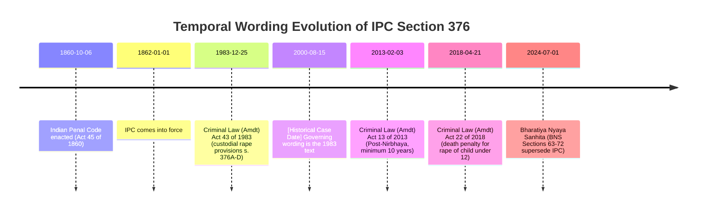
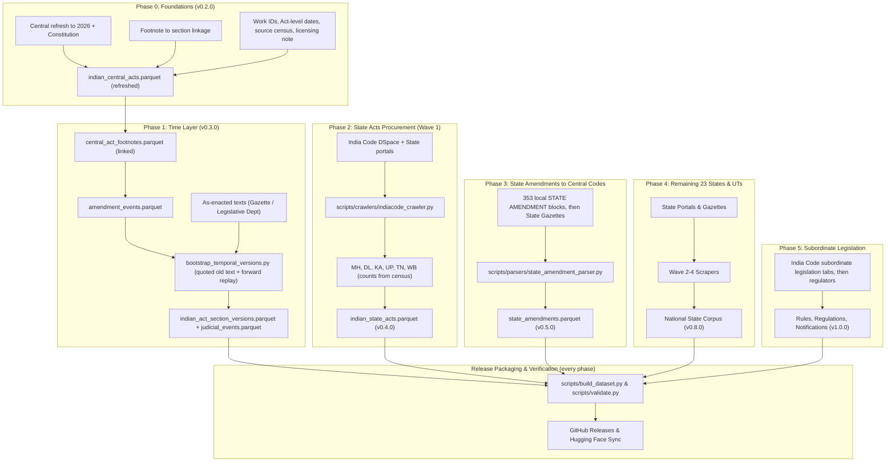

# Open Laws India: Statutory Procurement & Expansion Roadmap

> **Target Repository**: `kanoonhq/open-laws`  
> **Licensing**: [CC0 1.0 Universal (Public Domain Dedication)](https://creativecommons.org/publicdomain/zero/1.0/) for project contributions; statutory text subject to the licensing note in §9  
> **Status**: Living Engineering Blueprint & Execution Plan  
> **Canonical Distribution**: [GitHub Releases](https://github.com/kanoonhq/open-laws/releases) & [Hugging Face Datasets](https://huggingface.co/datasets/kanoonhq/open-laws)

---

## 1. Executive Summary & Objectives

`kanoonhq/open-laws` is the open, public-domain statutory foundation for Indian legal intelligence. As of **v0.1.1**, the repository contains **861 Central Acts (1838–2023), 36,895 sections, 28,656 amendment footnotes (22,490 with parsed `w.e.f.` dates), and 107 criminal transition mappings** (IPC↔BNS, CrPC↔BNSS, Evidence↔BSA).

**Known coverage gaps in v0.1.1** (measured against `data/`):
- **No Central Acts from 2024–2026**, and only 3 from 2023 (BNS, BNSS, BSA). Missing examples include the Digital Personal Data Protection Act, 2023, the Telecommunications Act, 2023, the Income-tax Act, 2025 and the Immigration and Foreigners Act, 2025.
- **The Constitution of India** and its amendment history are absent.
- Repeal is a boolean (`is_repealed`) with no repeal, commencement or savings dates; 697 of 861 Acts carry the fallback category `general`.
- Footnotes are anchored to India Code page numbers (`Page N`), not to sections.

Beyond Central Acts, Indian statutory law comprises an *estimated* **15,000–22,000 State Acts, 100,000+ subordinate rules/regulations/notifications, and amendment chains dating from the 1830s to 2026**. These figures are unverified estimates and will be replaced by the Phase 0 source census.

This document outlines the engineering architecture and procurement pipeline executed directly within this repository to expand `open-laws` into the complete, authoritative, and point-in-time statutory corpus of India.

### Core Objectives
1. **Point-in-Time Temporal Legislation ("Statutory Time Machine")**:  
   Enable advocates, courts, and researchers to retrieve statutory wording as it stood on *any given historical date* (e.g. 15 August 2000 vs 1 July 2024), honouring Article 20(1) (no conviction except under the law in force at the time of the act), savings and transition clauses, and civil cause-of-action crystallization.
2. **Complete, Current Central Corpus**:  
   Close the 2023–2026 gap, add the Constitution with all amendments, and keep Act-level assent, commencement and repeal dates.
3. **State Acts Procurement (Waves 1–4)**:  
   Ingest the statutes of all 28 States and the 3 Union Territories with legislatures (Delhi, Puducherry, Jammu & Kashmir), plus Art. 240 Regulations for the other UTs, prioritizing commercial and high-litigation jurisdictions (**Maharashtra, Delhi, Karnataka, Uttar Pradesh, Tamil Nadu, and West Bengal**).
4. **State Amendments to Concurrent List Central Codes**:  
   Capture state-specific variations for core procedural codes (Code of Civil Procedure, Code of Criminal Procedure / BNSS, Indian Stamp Act, Court Fees Act, Registration Act).
5. **Procedural First-Class Units**:  
   Properly ingest and structure Schedules, Orders (CPC Orders I–LI), Rules, statutory forms, and sub-section level provisions (clauses, provisos, explanations, illustrations).
6. **Judicial Validity Events**:  
   Record when a court strikes down, reads down, stays or upholds a provision, so a point-in-time query reflects enforceability, not just enacted wording.
7. **Authoritative Languages**:  
   Ingest Hindi texts of Central Acts (authoritative under the Authoritative Texts (Central Laws) Act, 1973) and record the authoritative language of State Acts (Art. 348(3)).
8. **Provenance & Confidence on Every Record**:  
   Every row carries its source URL, source hash, retrieval time, parser version, and whether its text is verbatim from a source or machine-reconstructed.
9. **Zero-Cost Public-Domain Distribution**:  
   Package and publish all data as dual-distribution Apache Parquet (zstandard) and JSON Lines (.jsonl.gz) via GitHub Releases and Hugging Face Datasets with SHA-256 cryptographic manifests.

---

## 2. Target Dataset Architecture & Schemas

### 2.1 Identifiers

The current `act_id` pattern (`^A[0-9]{4}-[0-9]+$`, e.g. `A1860-45`) has no jurisdiction or document type, so *Maharashtra Act 5 of 1950* and *Central Act 5 of 1950* would collide, as would ordinances, regulations and President's Acts. New records use jurisdiction-qualified identifiers modelled on Akoma Ntoso / ELI FRBR naming:

| Level | Pattern | Example |
| :--- | :--- | :--- |
| Work (the instrument) | `{jurisdiction}/{doc_type}/{year}/{number}` | `in-central/act/1860/45`, `in-mh/act/1950/5` |
| Expression (point-in-time text) | `{work}/{lang}@{valid_from}` | `in-central/act/1860/45/eng@2013-02-03` |
| Provision | `{work}/~{provision_path}` | `in-central/act/1860/45/~sec_376__subsec_2__cl_a` |

- `doc_type` ∈ `act`, `ordinance`, `regulation` (Art. 240), `presidents_act`, `rule`, `regulation_subordinate`, `notification`, `order`, `constitution`, `constitution_amendment`.
- The existing `act_id` (`A1860-45`) is kept as a **legacy alias column** on Central Acts so existing consumers do not break. Note that IDs are not zero-padded (`A1908-5`, not `A1908-05`).
- IDs, once published, are never reused or reassigned.

### 2.2 Tables

The dataset expands from 4 tables to the following canonical tables under `data/`:

```
data/
├── manifest.json                             # SHA-256 hashes, row counts, coverage report
├── indian_central_acts.parquet               # (Existing) 861 Central Acts → refreshed to 2026
├── indian_central_act_sections.parquet       # (Existing) 36,895 Sections
├── central_act_footnotes.parquet             # (Existing) 28,656 Footnotes (22,490 w.e.f. dates)
├── criminal_law_mappings.parquet             # (Existing) 107 Transition mappings
├── jurisdictions.parquet                     # [NEW] Jurisdictions with validity intervals & succession
├── amendment_events.parquet                  # [NEW] Event timeline: who amended what, when
├── commencement_notifications.parquet        # [NEW] Gazette notifications bringing provisions into force
├── indian_act_section_versions.parquet       # [NEW] Bi-temporal historical section slices
├── provisions.parquet                        # [NEW] Sub-section / clause / proviso tree
├── judicial_events.parquet                   # [NEW] Court rulings affecting provision validity
├── state_amendments.parquet                  # [NEW] State variations to Central Codes
├── indian_state_acts.parquet                 # [NEW] State bare acts & statutes
├── indian_state_act_sections.parquet         # [NEW] State act sections & provisions
└── indian_central_acts_complete.jsonl.gz     # (Existing) Hierarchical monolithic archive
```

### Table 1: `amendment_events.parquet` (`schemas/amendment_event.schema.json`)
One row per amending operation. This is the backbone of the time layer and can be built deterministically from footnotes even where the old wording is unknown.

| Column | Type | Description |
| :--- | :--- | :--- |
| `id` | `string` | Deterministic ID e.g. `A1860-45:ev:A2013-13:s9` |
| `act_id` | `string` | Amended Act |
| `provisions_affected` | `list<string>` | Section slugs / provision paths affected |
| `operation` | `string` | `substitution`, `insertion`, `omission`, `renumbering`, `extension`, `repeal`, `other` |
| `amending_instrument_id` | `string?` | Canonical ID of the amending Act / Ordinance / Order |
| `amending_citation` | `string?` | e.g. `Act 13 of 2013, s. 9` |
| `assent_date` | `date32?` | Assent to the amending instrument |
| `publication_date` | `date32?` | Gazette publication |
| `commencement_date` | `date32?` | Date the amendment came into force |
| `wef_date` | `date32?` | `w.e.f.` date as printed (may differ from commencement) |
| `is_retrospective` | `bool` | `wef_date` earlier than `publication_date` |
| `old_text` | `string?` | Replaced wording, when the footnote quotes it (`for "…"`) |
| `footnote_ids` | `list<string>` | Source footnotes |
| `commencement_notification_id` | `string?` | Link into `commencement_notifications` |

### Table 2: `indian_act_section_versions.parquet` (`schemas/section_version.schema.json`)
Stores the bi-temporal slices for point-in-time statutory reconstruction. **Valid time** (`valid_from`/`valid_to`) records when the wording was law; **record time** (`recorded_from`/`recorded_to`) records which dataset releases asserted it, so corrections never silently rewrite history.

| Column | Type | Description |
| :--- | :--- | :--- |
| `id` | `string` | Deterministic ID e.g. `A1860-45:376:2013-02-03` (act, slug, valid_from) |
| `act_id` | `string` | Canonical Act ID e.g. `A1860-45` |
| `section_number` | `string` | Official section label as published e.g. `Section 376.` |
| `slug` | `string` | Normalized slug e.g. `376` (use this for joins and queries) |
| `structural_unit` | `string` | `section`, `order`, `rule`, `article`, `schedule` |
| `version_number` | `int32` | Sequential version index (1, 2, 3...) |
| `heading` | `string` | Marginal heading in force during this slice |
| `full_text` | `string?` | Statutory wording in force between `valid_from` and `valid_to` (null if `text_status = unavailable`) |
| `valid_from` | `date32` | Commencement / effective date of this version |
| `valid_to` | `date32?` | Date superseded by next event (`null` if current) |
| `status` | `string` | `in_force`, `not_commenced`, `repealed`, `omitted`, `expired`, `struck_down`, `stayed`, `ordinance_lapsed` |
| `text_status` | `string` | `verbatim_source`, `reconstructed`, `unavailable` |
| `confidence` | `float32` | 1.0 for verbatim; lower for reconstructed text |
| `amendment_event_ids` | `list<string>` | Events that opened this slice |
| `amended_by_act_id` | `string?` | Canonical ID of the amending Act |
| `amendment_citation` | `string?` | e.g. `Act 13 of 2013, s. 9` |
| `change_summary` | `string?` | e.g. `Substituted by Act 13 of 2013; minimum term raised to 10 years` |
| `footnote_references` | `list<string>` | IDs of originating footnotes |
| `source_url` | `string` | Where the text was obtained |
| `source_sha256` | `string` | Hash of the raw source response |
| `retrieved_at` | `timestamp` | Retrieval time |
| `parser_version` | `string` | Parser / reconstruction version |
| `recorded_from` | `string` | First dataset release asserting this row (e.g. `v0.3.0`) |
| `recorded_to` | `string?` | Release that superseded this row (`null` if current) |
| `language` | `string` | Default `en` |

### Table 3: `commencement_notifications.parquet`
Gazette notifications that bring Acts or specific provisions into force. Needed for phased commencement (e.g. the Labour Codes, the DPDP Act and its Rules) and for sections that are enacted but not yet in force.

| Column | Type | Description |
| :--- | :--- | :--- |
| `id` | `string` | e.g. `egazette:SO-1234(E):2024-02-23` |
| `act_id` | `string` | Act being commenced |
| `notification_number` | `string` | `S.O.` / `G.S.R.` number |
| `gazette_date` | `date32` | Date of publication |
| `effective_date` | `date32` | Date appointed |
| `provisions` | `list<string>` | Provisions brought into force (empty = whole Act) |
| `source_url`, `source_sha256` | `string` | Provenance |

### Table 4: `judicial_events.parquet`
Court rulings that change whether a provision is enforceable. Initial seed:

| Provision | Case | Date | Effect |
| :--- | :--- | :--- | :--- |
| IT Act 2000, s. 66A | *Shreya Singhal v. Union of India* | 2015-03-24 | `struck_down` |
| IPC s. 377 | *Navtej Singh Johar v. Union of India* | 2018-09-06 | `read_down` |
| IPC s. 497 | *Joseph Shine v. Union of India* | 2018-09-27 | `struck_down` |
| IPC s. 124A | *S.G. Vombatkere v. Union of India* | 2022-05-11 | `stayed` (held in abeyance) |

Columns: `id`, `act_id`, `provision_path`, `court`, `case_name`, `neutral_citation`, `decision_date`, `effect` (`struck_down`, `read_down`, `stayed`, `stay_lifted`, `upheld`), `scope_note`, `source_url`. A `struck_down`/`stayed` event closes the provision's `in_force` slice and opens a slice with the matching `status`.

### Table 5: `provisions.parquet`
Hierarchical tree under each section: sub-section, clause, sub-clause, proviso, explanation, illustration. Columns: `id`, `section_id`, `parent_id`, `path` (e.g. `376(2)(a)`), `unit_type`, `label`, `text`, `ordinal`. Legal citation and retrieval-augmented generation operate at this level ("s. 376(2)(a)"), not at whole-section level.

### Table 6: `jurisdictions.parquet`
One row per jurisdiction with `valid_from`/`valid_to` and `successor_of` / `inherited_laws_from` links, covering reorganisations such as Bombay → Maharashtra & Gujarat (1960), Punjab → Haryana (1966), the 2000 splits (UP/Uttarakhand, MP/Chhattisgarh, Bihar/Jharkhand), Andhra Pradesh → Telangana (2014), and Jammu & Kashmir (2019, Fifth Schedule of the Reorganisation Act repealing or saving State laws). Codes follow a pinned version of ISO 3166-2:IN with an alias table for historical codes (e.g. `IN-TS`/`IN-TG`, `IN-CG`/`IN-CT`, `IN-UL`/`IN-UT`, `IN-OR`/`IN-OD`); verify each against the current ISO list before freezing.

### Table 7: `state_amendments.parquet` (`schemas/state_amendment.schema.json`)
Stores state-specific amendments to Central Acts (Concurrent List):

| Column | Type | Description |
| :--- | :--- | :--- |
| `id` | `string` | Deterministic ID e.g. `A1908-5:s115:IN-UP` |
| `central_act_id` | `string` | e.g. `A1908-5` (CPC) |
| `section_number` | `string` | Section affected (e.g. `115`, `Order VIII Rule 1`) |
| `state_jurisdiction` | `string` | ISO 3166-2:IN code (e.g. `IN-UP`, `IN-MH`) |
| `state_act_reference` | `string` | e.g. `U.P. Act 31 of 1978, s. 2` |
| `amendment_type` | `string` | `substitution`, `insertion`, `omission`, `proviso` |
| `amended_text` | `string` | The text applicable within the state |
| `effective_date` | `date32?` | Date when state amendment took effect |
| `valid_to` | `date32?` | Date the state amendment ceased to apply |
| `source_url` | `string` | Provenance |

Many states have their **own** Stamp and Court Fees Acts (e.g. the Maharashtra Stamp Act, 1958; the Karnataka Stamp Act, 1957). Those are modelled as State Acts, not as rows in `state_amendments`.

### Table 8: `indian_state_acts.parquet` & `indian_state_act_sections.parquet`
Extends the existing `act.schema.json` and `section.schema.json` with the jurisdiction-qualified work ID (§2.1), `jurisdiction` set to state ISO codes (`IN-MH`, `IN-DL`, `IN-KA`, etc.), `doc_type`, and `authoritative_language` (for Hindi-legislating states the English translation published under Art. 348(3) is authoritative; record both where available).

### Changes to existing tables
- `indian_central_acts`: add `work_id`, `doc_type`, `assent_date`, `commencement_date`, `repeal_date`, `repealed_by`, `savings_clause` (e.g. `BNSS s. 531`); replace keyword `category` with a reviewed subject classification.
- `central_act_footnotes`: add `section_slug` (linkage from Phase 0) and `linkage_method`.
- `criminal_law_mappings`: add `effective_from` (`2024-07-01`) and `applies_by` (`offence_date` for substantive law, `proceeding_date` for procedure per savings clauses).

---

## 3. The Temporal Imperative: Point-in-Time Architecture

Indian litigation routinely spans decades. Under **Article 20(1) of the Constitution of India**, no person can be convicted of any offence except for violation of a law in force at the time of the commission of the act charged. Civil rights, tax assessments, and contractual liabilities similarly crystallize on specific historical dates:



### Transition & Savings Rules
Point-in-time lookup is not only "which wording was in force on date D". The governing law depends on *what* date matters:
- **Substantive offences** follow the date of the offence (Art. 20(1)): an offence committed on 30 June 2024 is charged under the IPC even if tried later.
- **Procedure and evidence** follow the savings clauses (BNSS s. 531, BSA s. 170): proceedings pending on 1 July 2024 continue under the CrPC / Evidence Act.
- **State amendments to the CrPC do not carry over to the BNSS**; a state must amend the BNSS afresh. These are tracked as separate `state_amendments` rows with `valid_to`.

`criminal_law_mappings.applies_by` encodes which rule applies.

### Point-in-Time Query Logic (DuckDB SQL)
```sql
-- Query section wording as of 15 August 2000
SELECT act_id, section_number, heading, full_text,
       status, text_status, confidence, amendment_citation
FROM 'indian_act_section_versions.parquet'
WHERE act_id = 'A1860-45'
  AND slug = '376'
  AND valid_from <= DATE '2000-08-15'
  AND (valid_to IS NULL OR valid_to > DATE '2000-08-15')
  AND recorded_to IS NULL            -- latest dataset assertion
ORDER BY valid_from DESC
LIMIT 1;
-- Consumers must surface text_status: 'reconstructed' text is labelled, 'unavailable' returns no text.
```

---

## 4. Official Data Sources & Scraping Topography

| Portal | Target Data | API / Protocol | Rate Limits / Resilience Strategy | Licence / Terms |
| :--- | :--- | :--- | :--- | :--- |
| **India Code DSpace** (`indiacode.nic.in`) | Central & State Acts, Section Text, Hindi texts, per-Act subordinate legislation tabs (Rules, Regulations, Notifications, Orders, Ordinances) | REST (`/handle/123456789/{handle}`, `/SectionPageContent`) | Policy in §6; cached in `.cache/indiacode/` | Check site terms |
| **Legislative Department** (`legislative.gov.in`) | As-enacted Central Acts, chronological list of Central Acts, Repealing & Amending Acts | HTTPS / PDF | Policy in §6; cached in `.cache/legislative/` | Check site terms |
| **e-Gazette of India** (`egazette.gov.in`) | Amending Acts, Commencement Notifications (S.O./G.S.R.) | Search portal (PDF/OCR) | PDF extraction via `pypdf`/`pdfplumber`, cached in `.cache/egazette/` | s. 52(1)(q)(i) (gazetted matter) |
| **Digital Sansad** (`sansad.in`) | Bills, Parliamentary Committee Reports | REST / Open Web | Legislative intent and statement of objects | s. 52(1)(q)(iii) (reports laid on the Table) |
| **Law Commission of India** | Reports | HTTPS / PDF | Legislative intent | Check site terms |
| **Regulators** (SEBI, RBI, CBIC/GST, CBDT, MCA, IBBI) | Regulations, Rules, Notifications, Master Directions, Circulars | HTTPS / PDF | Per-domain limits | Gazetted items: s. 52(1)(q)(i); **ungazetted circulars need a licence check** |
| **State Law / Legislative Department portals & State Gazettes** | State Acts, Ordinances, Rules, State amendments | HTTPS Web Scrape | Per-domain limits | Catalogued per state in Phase 0 (no URL is assumed until verified) |

---

## 5. Wave-by-Wave Execution Roadmap



### Phase 0: Foundations (Immediate Execution)
- **Central refresh**: ingest all Central Acts through 2026 (including the 2023 Acts beyond BNS/BNSS/BSA) and the Constitution of India with every Constitutional Amendment Act as `amendment_events`.
- **Footnote → section linkage**: 99.99% of footnotes are anchored to `Page N` and footnote numbers restart per page. Link them using the inline markers in section text (`N[`, ~21% of sections carry markers) plus the page order of sections. Publish the linkage rate per Act; unlinked footnotes stay at Act level.
- **Act-level dates**: assent, commencement and repeal dates and savings clauses for every Central Act (e.g. IPC, CrPC and the Evidence Act repealed with effect from 2024-07-01, savings under BNSS s. 531 / BSA s. 170).
- **Identifier scheme** (§2.1) with the legacy `act_id` alias.
- **Source census**: per-state counts of Acts available on India Code vs State portals, replacing the estimates in §1 and Phase 2.
- **Licensing note** (§9).
- **Milestone**: Release **v0.2.0**.

### Phase 1: Time Layer
Footnotes record *that* a provision changed and when, but only ~27% quote the replaced wording (`for "…"`), and large substitutions (e.g. "Subs. by Act 13 of 2013, s. 9, for sections 375, 376…") keep none of it. Footnotes alone therefore yield an **event timeline**, not full historical text. The phase runs in this order:
1. **Build `amendment_events`** deterministically from linked footnotes (operation, amending Act, `w.e.f.` date, quoted old text).
2. **Reverse-reconstruct** earlier versions where the footnote quotes the old wording.
3. **Forward-replay** from as-enacted text (e-Gazette / Legislative Department) for the priority codes, applying each amending Act in date order. **The replayed final state must equal the current India Code text** after normalisation; any mismatch blocks the version from publication.
4. **Mark everything else `text_status = unavailable`** with the event still recorded. Never guess wording.
5. **Seed `judicial_events`** (§2.2 Table 4).
- **Target Codes**: IPC 1860, CrPC 1973, CPC 1908, Indian Evidence Act 1872, Negotiable Instruments Act 1881, Arbitration and Conciliation Act 1996, Companies Act 2013, Income-tax Act 1961.
- **Output**: `data/amendment_events.parquet`, `data/indian_act_section_versions.parquet`, `data/judicial_events.parquet` and their schemas.
- **Milestone**: Release **v0.3.0**.

### Phase 2: India Code State Acts Crawler (Wave 1: Top 6 Commercial Jurisdictions)
- **Scope**: Ingest primary State Acts for India's 6 largest commercial and litigation jurisdictions. Act counts below are rough estimates, to be replaced by Phase 0 census figures:
  1. Maharashtra (`IN-MH`) — ~900 (MCOCA, Maharashtra Police Act (formerly Bombay Police Act), Maharashtra Land Revenue Code, etc.)
  2. National Capital Territory of Delhi (`IN-DL`) — ~350 (Delhi Rent Control, Delhi Excise)
  3. Karnataka (`IN-KA`) — ~800 (Karnataka Land Revenue, Karnataka Police Act)
  4. Uttar Pradesh (`IN-UP`) — ~1,100 (UP Revenue Code, UP Gangsters Act, UP Urban Buildings Regulation)
  5. Tamil Nadu (`IN-TN`) — ~950 (TN Land Reforms, TN Prohibition, TN Buildings Lease & Rent Control)
  6. West Bengal (`IN-WB`) — ~850 (WB Land Reforms, WB Premises Tenancy Act)
- **Pre-reorganisation laws**: Bombay Acts still in force in Maharashtra and Gujarat are linked through `jurisdictions.inherited_laws_from`.
- **Language**: record `authoritative_language` per Act; capture the Hindi original and the Art. 348(3) English translation where both exist (relevant from Wave 1 for UP).
- **Crawler**: `scripts/crawlers/indiacode_crawler.py` with persistent disk cache in `.cache/indiacode/`.
- **Output**: `data/indian_state_acts.parquet` & `data/indian_state_act_sections.parquet`.
- **Milestone**: Release **v0.4.0**.

### Phase 3: State Amendments to Central Codes
- **Bootstrap offline first**: 353 sections in the existing corpus already contain "STATE AMENDMENT" blocks (CrPC 51, Indian Forest Act 34, Registration Act 30, Indian Stamp Act 22, IPC 16, …). Parse these before any network crawl, then fill gaps from State Gazettes.
- **Scope**: State-specific amendments to Concurrent List statutes:
  - Code of Civil Procedure, 1908 (Order VIII Rule 1 written statement timeline variations, s. 115 revision jurisdiction).
  - Code of Criminal Procedure, 1973 (e.g. s. 438 anticipatory bail: omitted in UP in 1976, restored in 2019), closed at the BNSS transition; BNSS state amendments tracked separately.
  - Indian Stamp Act, 1899 (state schedules, where the state has not enacted its own Stamp Act).
  - Registration Act, 1908 (State-mandated registration categories).
- **Parser**: `scripts/parsers/state_amendment_parser.py`.
- **Output**: `data/state_amendments.parquet`.
- **Milestone**: Release **v0.5.0**.

### Phase 4: Remaining 23 States & UTs (Waves 2–4)
- **Wave 2 (High-Volume States)**: Gujarat (`IN-GJ`), Rajasthan (`IN-RJ`), Madhya Pradesh (`IN-MP`), Punjab (`IN-PB`), Haryana (`IN-HR`), Kerala (`IN-KL`), Andhra Pradesh (`IN-AP`), Telangana (`IN-TG`), Bihar (`IN-BR`).
- **Wave 3 (Mid-Volume States & J&K)**: Odisha (`IN-OR`), Assam (`IN-AS`), Jharkhand (`IN-JH`), Chhattisgarh (`IN-CT`), Uttarakhand (`IN-UT`), Himachal Pradesh (`IN-HP`), Jammu & Kashmir (`IN-JK`, including pre-2019 State laws and their repeal/saving under the Reorganisation Act), Goa (`IN-GA`).
- **Wave 4 (Northeastern States & UTs)**: Manipur, Meghalaya, Mizoram, Nagaland, Tripura, Arunachal Pradesh, Sikkim, Puducherry; Art. 240 Regulations for Chandigarh, Andaman & Nicobar, Ladakh, Lakshadweep, and Dadra & Nagar Haveli and Daman & Diu.
- **Milestone**: Release **v0.8.0** (target set by census, not the §1 estimate).

### Phase 5: Central Rules & Subordinate Legislation
- **Start with India Code's per-Act subordinate legislation tabs** (Rules, Regulations, Notifications, Orders), which are already keyed to parent Acts.
- **Then regulators**: Companies Rules (MCA), SEBI Regulations, Insolvency Regulations (IBBI), GST Rules & Notifications (CBIC), Income-tax Rules & Notifications (CBDT), RBI Master Directions (licence check required for ungazetted material).
- **Milestone**: Release **v1.0.0** (The Comprehensive Indian Statutory Universe).

### Parallel Track: Authoritative Hindi Texts
Ingest Hindi texts of Central Acts from India Code as `language = 'hi'` rows sharing work IDs with the English expressions, starting with the 8 Phase 1 priority codes and BNS/BNSS/BSA.

---

## 6. Scraper Engineering & Resilience Design

Government portals (specifically `indiacode.nic.in` and `egazette.gov.in`) present high latency, intermittent connection drops, and strict connection throttling. The crawler architecture enforces:

```
┌────────────────────────────────────────────────────────┐
│               indiacode_crawler.py                      │
└────────────────────────┬───────────────────────────────┘
                         │
        ┌────────────────▼────────────────┐
        │  Check .cache/indiacode/{hash}  │
        └───────┬──────────────────┬──────┘
       Cache Hit│                  │Cache Miss
                │                  ▼
                │       ┌───────────────────────┐
                │       │ Polite Rate Limiter   │
                │       │ (≤2 conn, ≥500ms +    │
                │       │  200-500ms jitter)    │
                │       └──────────┬────────────┘
                │                  ▼
                │       ┌───────────────────────┐
                │       │ Exponential Backoff   │
                │       │ (Retries 429/503/504) │
                │       └──────────┬────────────┘
                │                  ▼
                │       ┌───────────────────────┐
                │       │ Fetch DSpace / Section│
                │       └──────────┬────────────┘
                │                  ▼
                │       ┌───────────────────────┐
                │       │ Save to Local Cache   │
                │       │ + Raw Snapshot (WARC) │
                │       └──────────┬────────────┘
                │                  │
                ▼                  ▼
┌────────────────────────────────────────────────────────┐
│          Standardized JSONL Data Stream                │
└────────────────────────────────────────────────────────┘
```

1. **Content Addressable Local Cache**: Every HTTP response is hashed and cached under `.cache/indiacode/` (gitignored). A crawler run can be interrupted and resumed at any time with zero redundant requests.
2. **Single Politeness Policy (all portals)**: At most 2 concurrent connections per host; at least 500ms between requests plus 200–500ms randomized jitter; honour `robots.txt`; send an identifying `User-Agent` with a project contact address; check each portal's terms before crawling.
3. **Adaptive Backoff**: HTTP 429, 503 or 504 triggers a 10s → 30s → 60s backoff with automatic session re-establishment.
4. **Raw Snapshot Archive**: Raw responses are kept as content-addressed WARC files and published as a separate raw-snapshot dataset, so every published record can be traced to, and re-parsed from, the exact bytes it came from (`source_sha256`).
5. **HTML Sanitization & Normalization**: Strips decorative inline styling, fonts, and Microsoft Word artifacts from raw India Code HTML, preserving semantic hierarchy (`<p>`, `<b>`, `<i>`, `<table>`, `<ol>`, `<li>`). **Footnote markers (`N[ … ]`) and table structure are preserved**, since Phase 0 linkage and Schedule parsing depend on them.

---

## 7. Quality Gates & Validation (`scripts/validate.py`)

No dataset release is published without passing 100% of automated checks:
1. **Schema Conformance**: Every record is validated against its respective JSON Schema in `schemas/*.schema.json`.
2. **Cryptographic Checksums**: Every parquet and jsonl file must match its exact SHA-256 hash in `data/manifest.json`.
3. **Temporal Invariant Tests**: For all records in `indian_act_section_versions.parquet`:
   $$\text{valid\_from} \le \text{valid\_to} \quad (\forall \text{ valid\_to} \neq \text{null})$$
   - No overlapping temporal intervals for the same `(act_id, slug, language)` within a release.
   - No unexplained gaps: every interval between an Act's commencement and its repeal is covered by a slice with an explicit `status`.
   - Every version links to at least one `amendment_event` (or is version 1), and every event links to a source (footnote, gazette notification or judgment).
4. **Replay Check**: For every forward-replayed provision, the final reconstructed version must equal the current published text after normalisation.
5. **Golden Set**: ≥200 hand-verified `(provision, date) → text` pairs across the priority codes; reconstruction precision is reported in every release and must not regress.
6. **Cross-Reference Integrity**:
   - Every `act_id` referenced in sections, footnotes, events or versions must exist in `indian_central_acts.parquet` or `indian_state_acts.parquet`.
   - Every `central_act_id` in `state_amendments.parquet` must resolve to a valid Central Act.
   - Every jurisdiction code must exist in `jurisdictions.parquet`.
7. **Identifier Uniqueness**: Work IDs are unique across all jurisdictions and document types; no previously published ID is reused.
8. **Slug Collision Free**: Canonical slugs (`slug`) must be unique per `(act_id, structural_unit, language)`.
9. **Coverage Report**: `manifest.json` records per-jurisdiction and per-Act counts, footnote linkage rate, and the share of versions that are `verbatim_source` vs `reconstructed` vs `unavailable`.

---

## 8. Distribution & Downstream Consumption

### Dual Distribution Channels ($0 Free Storage)
- **GitHub Releases (`kanoonhq/open-laws`)**:
  - Parquet and compressed JSONL releases tagged by version (`v0.1.0`, `v0.2.0`, ...).
  - Downloadable via `gh release download` or direct curl.
  - The monolithic archive keeps its current path, `data/indian_central_acts_complete.jsonl.gz`.
- **Hugging Face Datasets (`kanoonhq/open-laws`)**:
  - Live parquet files enabling streaming queries via DuckDB and the Python `datasets` library, with one config per table (`acts`, `sections`, `footnotes`, `mappings`, `versions`, `events`, `provisions`, `judicial_events`, `state_acts`, `state_amendments`, ...):
    ```python
    from datasets import load_dataset
    versions = load_dataset("kanoonhq/open-laws", "versions", split="train")
    ```
- **Changelog & Stability**: every release ships a `CHANGELOG` entry listing added, corrected and superseded rows; corrections are expressed through `recorded_to`, never by silently editing published rows.

### KanoonHQ Downstream Sync
When KanoonHQ is ready to ingest updates from `open-laws`:
- Run `apps/api/scripts/sync_from_open_laws.py` in KanoonHQ.
- Downloads verified release assets, verifies SHA-256 hashes against `manifest.json`, and loads updates directly into PostgreSQL with zero schema churn.

### Future: Judgment Corpus (separate dataset)
Full Supreme Court and High Court judgment text is out of scope for this repository. Open judgment collections exist under CC-BY licences (e.g. on the AWS Open Data Registry), which are not CC0-compatible, so a judgment corpus would be a separate dataset that links to this one through statute citations (`work_id` + `provision_path`). Only rulings that change a provision's validity are recorded here, in `judicial_events`.

---

## 9. Licensing Note (to be reviewed before v0.2.0)

The current README summarises Section 52(1)(q) of the Copyright Act, 1957 as a blanket exemption. That summary is imprecise and needs legal review:
- **s. 52(1)(q)(i)** covers matter published in the Official Gazette, **except an Act of a Legislature**.
- **s. 52(1)(q)(ii)** covers an Act of a Legislature **on the condition that it is reproduced together with commentary or other original matter**.
- **s. 52(1)(q)(iii)** covers reports of government-appointed committees and commissions laid on the Table of the Legislature, unless prohibited.
- **s. 52(1)(q)(iv)** covers judgments and orders of courts and tribunals, unless prohibited.
- Government works otherwise carry government copyright (s. 17(d), s. 28).

Actions: have the note reviewed by counsel; state that CC0 applies to the project's own contributions (structure, metadata, annotations, IDs, reconstructions); keep original matter alongside statutory text; record licence/terms per source (§4); and exclude, or separately license, any source whose terms do not permit redistribution.
