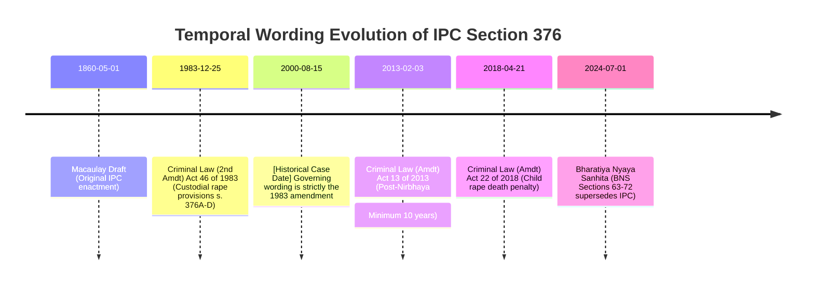
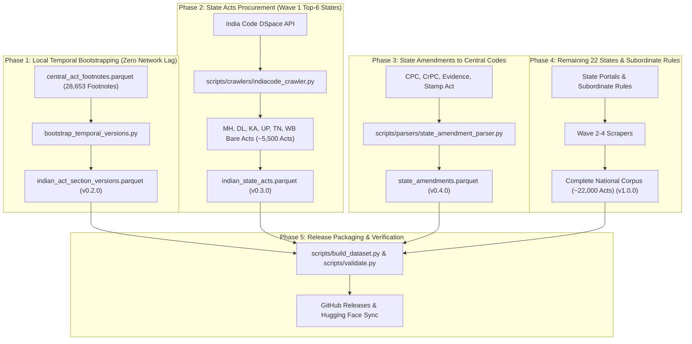

# Open Laws India: Statutory Procurement & Expansion Roadmap

> **Target Repository**: `kanoonhq/open-laws`  
> **Licensing**: [CC0 1.0 Universal (Public Domain Dedication)](https://creativecommons.org/publicdomain/zero/1.0/)  
> **Status**: Living Engineering Blueprint & Execution Plan  
> **Canonical Distribution**: [GitHub Releases](https://github.com/kanoonhq/open-laws/releases) & [Hugging Face Datasets](https://huggingface.co/datasets/kanoonhq/open-laws)

---

## 1. Executive Summary & Objectives

`kanoonhq/open-laws` is the open, public-domain statutory foundation for Indian legal intelligence. In its initial release (v0.1.0), the repository contains **861 Central Acts, 35,836 sections, 28,653 amendment footnotes, and 107 criminal transition mappings** (IPC↔BNS, CrPC↔BNSS, Evidence↔BSA).

While this covers ~90–95% of active Central Acts, Indian statutory law comprises an estimated **15,000–22,000 State Acts, over 100,000 subordinate rules/regulations, and extensive historical amendment chains dating from 1850 to 2026**.

This document outlines the engineering architecture and procurement pipeline executed directly within this repository to expand `open-laws` into the complete, authoritative, and point-in-time statutory corpus of India.

### Core Objectives
1. **Point-in-Time Temporal Legislation ("Statutory Time Machine")**:  
   Enable advocates, courts, and researchers to retrieve statutory wording as it stood on *any given historical date* (e.g. 15 August 2000 vs 1 July 2024), satisfying the constitutional mandate of Article 20(1) (ex-post facto prohibition) and civil cause-of-action crystallization.
2. **State Acts Procurement (Waves 1–4)**:  
   Ingest the active statutes of all 28 States and 3 Union Territories with legislative assemblies, prioritizing commercial and high-litigation states (**Maharashtra, Delhi, Karnataka, Uttar Pradesh, Tamil Nadu, and West Bengal**).
3. **State Amendments to Concurrent List Central Codes**:  
   Capture state-specific variations for core procedural codes (Code of Civil Procedure, Code of Criminal Procedure / BNSS, Indian Stamp Act, Court Fees Act, Registration Act).
4. **Procedural First-Class Units**:  
   Properly ingest and structure Schedules, Orders (CPC Orders I–LI), Rules, and statutory forms.
5. **Zero-Cost Public-Domain Distribution**:  
   Package and publish all data as dual-distribution Apache Parquet (zstandard) and JSON Lines (.jsonl.gz) via GitHub Releases and Hugging Face Datasets with SHA-256 cryptographic manifests.

---

## 2. Target Dataset Architecture & Schemas

The dataset expands from 4 tables to 7 canonical tables stored under `data/`:

```
data/
├── manifest.json                             # Cryptographic SHA-256 hashes & row statistics
├── indian_central_acts.parquet               # (Existing) 861 Central Acts
├── indian_central_act_sections.parquet       # (Existing) 35,836 Sections
├── central_act_footnotes.parquet             # (Existing) 28,653 Footnotes (22,490 w.e.f. dates)
├── criminal_law_mappings.parquet             # (Existing) 107 Transition mappings
├── indian_act_section_versions.parquet       # [NEW] Bi-temporal historical section slices
├── state_amendments.parquet                  # [NEW] State variations to Central Codes
├── indian_state_acts.parquet                 # [NEW] State bare acts & statutes
├── indian_state_act_sections.parquet         # [NEW] State act sections & provisions
└── releases/
    └── open_laws_india_complete.jsonl.gz     # Comprehensive monolithic archive
```

### Table 1: `indian_act_section_versions.parquet` (`schemas/section_version.schema.json`)
Stores the bi-temporal slices for point-in-time statutory reconstruction:

| Column | Type | Description |
| :--- | :--- | :--- |
| `id` | `string` | Deterministic ID e.g. `A1860-45:376:1983-12-25` |
| `act_id` | `string` | Canonical Act ID e.g. `A1860-45` |
| `section_number` | `string` | Official section label e.g. `376` |
| `slug` | `string` | Normalized slug e.g. `376` |
| `structural_unit` | `string` | `section`, `order`, `rule`, `article`, `schedule` |
| `version_number` | `int32` | Sequential version index (1, 2, 3...) |
| `heading` | `string` | Marginal heading in force during this slice |
| `full_text` | `string` | Statutory wording in force between `valid_from` and `valid_to` |
| `valid_from` | `date32` | Commencement / effective date of this version |
| `valid_to` | `date32?` | Date superseded by next amendment (`null` if current) |
| `amended_by_act_id` | `string?` | Canonical ID of the amending Act |
| `amendment_citation` | `string?` | e.g. `Act 13 of 2013, s. 9` |
| `change_summary` | `string?` | e.g. `Substituted by Act 13 of 2013; minimum term raised to 10 years` |
| `footnote_references` | `list<string>` | IDs of originating footnotes |
| `language` | `string` | Default `en` |

### Table 2: `state_amendments.parquet` (`schemas/state_amendment.schema.json`)
Stores state-specific amendments to Central Acts (Concurrent List):

| Column | Type | Description |
| :--- | :--- | :--- |
| `id` | `string` | Deterministic ID e.g. `A1908-05:s115:IN-UP` |
| `central_act_id` | `string` | e.g. `A1908-05` (CPC) |
| `section_number` | `string` | Section affected (e.g. `115`, `Order VIII Rule 1`) |
| `state_jurisdiction` | `string` | ISO 3166-2:IN code (e.g. `IN-UP`, `IN-MH`) |
| `state_act_reference` | `string` | e.g. `U.P. Act 31 of 1978, s. 2` |
| `amendment_type` | `string` | `substitution`, `insertion`, `omission`, `proviso` |
| `amended_text` | `string` | The text applicable within the state |
| `effective_date` | `date32?` | Date when state amendment took effect |

### Table 3: `indian_state_acts.parquet` & `indian_state_act_sections.parquet`
Extends the existing `act.schema.json` and `section.schema.json` with `jurisdiction` set to state ISO codes (`IN-MH`, `IN-DL`, `IN-KA`, etc.).

---

## 3. The Temporal Imperative: Point-in-Time Architecture

Indian litigation routinely spans decades. Under **Article 20(1) of the Constitution of India**, no person can be convicted of any offence except for violation of a law in force at the time of the commission of the act charged. Civil rights, tax assessments, and contractual liabilities similarly crystallize on specific historical dates:



### Point-in-Time Query Logic (Pure Python & DuckDB SQL)
```sql
-- Query section wording as of 15 August 2000
SELECT act_id, section_number, heading, full_text, amendment_citation
FROM 'indian_act_section_versions.parquet'
WHERE act_id = 'A1860-45'
  AND section_number = '376'
  AND valid_from <= DATE '2000-08-15'
  AND (valid_to IS NULL OR valid_to > DATE '2000-08-15')
ORDER BY valid_from DESC
LIMIT 1;
```

---

## 4. Official Data Sources & Scraping Topography

| Portal | Target Data | API / Protocol | Rate Limits / Resilience Strategy |
| :--- | :--- | :--- | :--- |
| **India Code DSpace** (`indiacode.nic.in`) | Central & State Acts, Section Text | REST (`/handle/123456789/{handle}`, `/SectionPageContent`) | Max 2 req/s, exponential backoff, SHA-256 response caching in `.cache/indiacode/` |
| **e-Gazette of India** (`egazette.gov.in`) | Amending Acts, Commencement Notifications | Search portal (PDF/OCR) | PDF extraction via `pypdf`/`pdfplumber`, cached in `.cache/egazette/` |
| **Digital Sansad** (`sansad.in`) | Bills, Parliamentary Committee Reports | REST / Open Web | Legislative intent and statement of objects |
| **State Government Portals** (e.g. `maharashtra.gov.in`, `delhigovt.nic.in`) | State Gazettes & Local Acts | HTTPS Web Scrape | Domain-specific rate limiting |

---

## 5. Wave-by-Wave Execution Roadmap



### Phase 1: Local Footnote Bootstrapping (Immediate Execution)
- **Scope**: Bootstrap historical section versions without waiting for external web crawls.
- **Input**: `data/central_act_footnotes.parquet` (28,653 footnotes, 22,490 `w.e.f.` dates) + `data/indian_central_act_sections.parquet`.
- **Target Codes**: IPC 1860, CrPC 1973, CPC 1908, Indian Evidence Act 1872, Negotiable Instruments Act 1881, Arbitration and Conciliation Act 1996, Companies Act 2013, Income Tax Act 1961.
- **Output**: `data/indian_act_section_versions.parquet` & `schemas/section_version.schema.json`.
- **Milestone**: Release **v0.2.0**.

### Phase 2: India Code State Acts Crawler (Wave 1: Top 6 Commercial States)
- **Scope**: Ingest primary State Acts for India's 6 largest commercial and litigation states:
  1. Maharashtra (`IN-MH`) — ~900 active acts (MCOCA, Bombay Police Act, Maharashtra Land Revenue Code, etc.)
  2. National Capital Territory of Delhi (`IN-DL`) — ~350 active acts (Delhi Rent Control, Delhi Excise, Delhi Police)
  3. Karnataka (`IN-KA`) — ~800 active acts (Karnataka Land Revenue, Karnataka Police Act, KPTCL)
  4. Uttar Pradesh (`IN-UP`) — ~1,100 active acts (UP Revenue Code, UP Gangsters Act, UP Urban Buildings Regulation)
  5. Tamil Nadu (`IN-TN`) — ~950 active acts (TN Land Reforms, TN Prohibition, TN Buildings Lease & Rent Control)
  6. West Bengal (`IN-WB`) — ~850 active acts (WB Land Reforms, WB Premises Tenancy Act)
- **Crawler**: `scripts/crawlers/indiacode_crawler.py` with persistent disk cache in `.cache/indiacode/`.
- **Output**: `data/indian_state_acts.parquet` & `data/indian_state_act_sections.parquet`.
- **Milestone**: Release **v0.3.0**.

### Phase 3: State Amendments to Central Codes
- **Scope**: Ingest state-specific amendments to Concurrent List statutes:
  - Code of Civil Procedure, 1908 (Order VIII Rule 1 written statement timeline variations, s. 115 revision jurisdiction).
  - Code of Criminal Procedure, 1973 / BNSS (Section 438 Anticipatory Bail modifications in UP, WB, and MH).
  - Indian Stamp Act, 1899 (State schedule duty rates).
  - Registration Act, 1908 (State-mandated registration categories).
- **Parser**: `scripts/parsers/state_amendment_parser.py`.
- **Output**: `data/state_amendments.parquet`.
- **Milestone**: Release **v0.4.0**.

### Phase 4: Remaining 22 States & UTs (Waves 2–4)
- **Wave 2 (High-Volume States)**: Gujarat (`IN-GJ`), Rajasthan (`IN-RJ`), Madhya Pradesh (`IN-MP`), Punjab (`IN-PB`), Haryana (`IN-HR`), Kerala (`IN-KL`), Andhra Pradesh (`IN-AP`), Telangana (`IN-TG`), Bihar (`IN-BR`).
- **Wave 3 (Mid-Volume States)**: Odisha (`IN-OR`), Assam (`IN-AS`), Jharkhand (`IN-JH`), Chhattisgarh (`IN-CT`), Uttarakhand (`IN-UT`), Himachal Pradesh (`IN-HP`), Jammu & Kashmir (`IN-JK`), Goa (`IN-GA`).
- **Wave 4 (Northeastern & UTs)**: Manipur, Meghalaya, Mizoram, Nagaland, Tripura, Arunachal Pradesh, Sikkim, Puducherry, Chandigarh, Andaman & Nicobar, Ladakh.
- **Milestone**: Release **v0.8.0** (~15,000+ Acts).

### Phase 5: Central Rules & Subordinate Legislation
- **Scope**: Key central subordinate legislation (Companies Rules, SEBI Regulations, Arbitration Rules, Insolvency Regulations, GST Rules).
- **Milestone**: Release **v1.0.0** (The Comprehensive Indian Statutory Universe).

---

## 6. Scraper Engineering & Resilience Design

Government portals (specifically `indiacode.nic.in` and `egazette.gov.in`) present high latency, intermittent connection drops, and strict connection throttling. The crawler architecture enforces:

```
┌────────────────────────────────────────────────────────┐
│               indiacode_crawler.py                      │
└────────────────────────┬───────────────────────────────┘
                         │
        ┌────────────────▼────────────────┐
        │  Check .cache/indiacode/{hash}  │
        └───────┬──────────────────┬──────┘
       Cache Hit│                  │Cache Miss
                │                  ▼
                │       ┌───────────────────────┐
                │       │ Polite Rate Limiter   │
                │       │ (2 req/s + 0.3s jitter│
                │       └──────────┬────────────┘
                │                  ▼
                │       ┌───────────────────────┐
                │       │ Exponential Backoff   │
                │       │ (Retries 429/503/504) │
                │       └──────────┬────────────┘
                │                  ▼
                │       ┌───────────────────────┐
                │       │ Fetch DSpace / Section│
                │       └──────────┬────────────┘
                │                  ▼
                │       ┌───────────────────────┐
                │       │ Save to Local Cache   │
                │       └──────────┬────────────┘
                │                  │
                ▼                  ▼
┌────────────────────────────────────────────────────────┐
│          Standardized JSONL Data Stream                │
└────────────────────────────────────────────────────────┘
```

1. **Content Addressable Local Cache**: Every HTTP response is hashed and cached under `.cache/indiacode/`. A crawler run can be interrupted and resumed at any time with zero redundant requests.
2. **Polite Concurrency**: Strict concurrency limit of 2 concurrent connections per IP; 500ms delay with 200–500ms randomized jitter.
3. **Adaptive Backoff**: HTTP 429 or 503 triggers a 10s $\to$ 30s $\to$ 60s backoff with automatic session re-establishment.
4. **HTML Sanitization & Normalization**: Strips decorative inline styling, fonts, and Microsoft Word artifacts from raw India Code HTML, preserving semantic hierarchy (`<p>`, `<b>`, `<i>`, `<table>`, `<ol>`, `<li>`).

---

## 7. Quality Gates & Validation (`scripts/validate.py`)

No dataset release is published without passing 100% of automated checks:
1. **Schema Conformance**: Every record is validated against its respective JSON Schema in `schemas/*.schema.json`.
2. **Cryptographic Checksums**: Every parquet and jsonl file must match its exact SHA-256 hash in `data/manifest.json`.
3. **Temporal Invariant Test**: For all records in `indian_act_section_versions.parquet`:
   $$\text{valid\_from} \le \text{valid\_to} \quad (\forall \text{ valid\_to} \neq \text{null})$$
   No overlapping temporal intervals for the same `(act_id, section_number, language)`.
4. **Cross-Reference Integrity**:
   - Every `act_id` referenced in sections or footnotes must exist in `indian_central_acts.parquet` or `indian_state_acts.parquet`.
   - Every `central_act_id` in `state_amendments.parquet` must resolve to a valid Central Act.
5. **Slug Collision Free**: Canonical slugs (`slug`) must be unique per `(act_id, structural_unit, language)`.

---

## 8. Distribution & Downstream Consumption

### Dual Distribution Channels ($0 Free Storage)
- **GitHub Releases (`kanoonhq/open-laws`)**:
  - Parquet and compressed JSONL releases tagged by version (`v0.1.0`, `v0.2.0`, ...).
  - Downloadable via `gh release download` or direct curl.
- **Hugging Face Datasets (`kanoonhq/open-laws`)**:
  - Live parquet files enabling streaming queries via DuckDB and the Python `datasets` library:
    ```python
    from datasets import load_dataset
    versions = load_dataset("kanoonhq/open-laws", data_files="indian_act_section_versions.parquet")
    ```

### KanoonHQ Downstream Sync
When KanoonHQ is ready to ingest updates from `open-laws`:
- Run `apps/api/scripts/sync_from_open_laws.py` in KanoonHQ.
- Downloads verified release assets, verifies SHA-256 hashes against `manifest.json`, and loads updates directly into PostgreSQL with zero schema churn.
